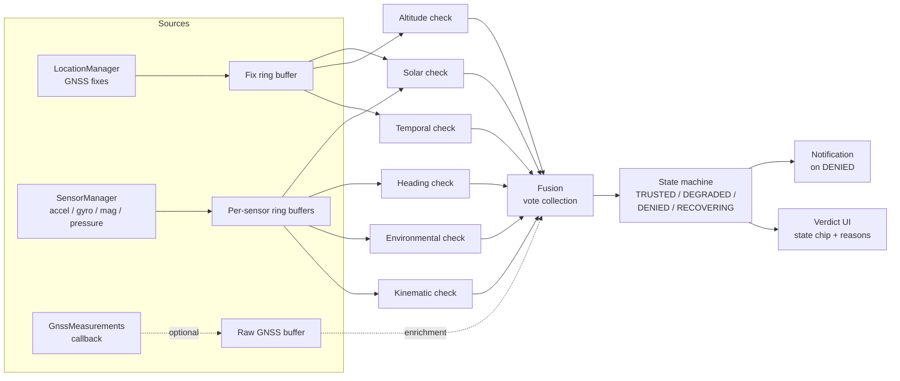

# Anchor — Sensor Pipeline Specification

Anchor decides whether the phone's GNSS fix is physically consistent with what its inertial,
magnetic, and barometric sensors say the phone is doing. The mock-location flag is treated as
advisory only; the verdict comes from six independent physical-consistency checks fused by a
deterministic state machine. This document describes how raw sensor data flows on a real Android
device and where reality diverges from the synthetic-data PoC.

## 1. Signal sources

| Signal | Android API | Notes |
|---|---|---|
| GNSS fixes (lat/lon/alt/speed/bearing/timestamp) | `LocationManager.requestLocationUpdates` (fused or `GPS_PROVIDER`) | ~1 Hz nominal; speed and bearing fields are derived from fix history by the chipset |
| Accelerometer | `SensorManager`, `TYPE_ACCELEROMETER` | reports gravity + linear acceleration; device frame |
| Linear acceleration | `TYPE_LINEAR_ACCELERATION` (software-fused by the platform) | convenience, see §5 |
| Gyroscope | `TYPE_GYROSCOPE` | angular velocity rad/s, integrates to orientation delta |
| Magnetometer | `TYPE_MAGNETIC_FIELD` | microtesla, device frame, needs calibration |
| Barometer | `TYPE_PRESSURE` | hPa; altitude via standard atmosphere |
| Raw GNSS (C/N0, AGC, pseudoranges) | `LocationManager.registerGnssMeasurementsCallback` | chipset-dependent availability, see §7 |

All sensor registrations go through `SensorManager.registerListener` with a `Handler` on a
dedicated worker thread. Never sample on the main thread; never do check math in the callback —
callbacks enqueue into ring buffers, checks drain them on their own schedule.

## 2. Realistic sampling rates

Rates vary significantly by device, driver quality, and requested latency
(`SENSOR_DELAY_GAME` etc. is a hint, not a contract). Plan around these:

| Sensor | Expected rate | Practical notes |
|---|---|---|
| Accelerometer | ~50 Hz (25–200 Hz depending on delay hint) | cheapest sensor on the device; most consistent |
| Magnetometer | ~50 Hz (often 10–60 Hz) | duty-cycled and noisier on some SoCs |
| Gyroscope | up to ~200 Hz at aggressive delay hints | we don't need >50 Hz; over-sampling costs battery |
| Barometer | ~1–5 Hz (Bosch parts can do more) | 1 Hz is plenty for our tolerance |
| GNSS fixes | ~1 Hz | some devices emit bursts under heavy load |
| GnssMeasurements | ~1–10 Hz, chipset-dependent | not guaranteed at all; treat as optional enrichment |

Timestamping: every sensor event carries `SensorEvent.timestamp` in nanoseconds on the
`SystemClock.elapsedRealtimeNanos()` clock base. Location fixes carry their own
elapsed-realtime-nanos timestamp. These share one clock and are the only safe basis for
cross-sensor alignment (§6). Do not mix `uptimeMillis`, wall clock, or GPS week-seconds into
alignment logic.

## 3. Buffering and windowing per check

All buffers are fixed-capacity ring buffers keyed by elapsed-realtime nanoseconds. No unbounded
history anywhere in the pipeline.

| Check | Window strategy | Typical size |
|---|---|---|
| Kinematic | last 2 fixes + accelerometer statistics over the inter-fix gap | 2 fixes + ~2 s of accel |
| Heading | N-sample sustained-divergence buffer: divergence angle per sample, flag only if divergence persists across the window (>30–40° median over multiple samples); single-sample divergence during turns is normal and must pass | ~10–20 s of heading pairs |
| Temporal / teleport | last-fix state only (position, timestamp); flags implied ground speed >1000 km/h | 1 fix |
| Altitude | barometric altitude slow-average vs GNSS altitude slow-average, both low-passed; weather drift budget absorbs hours-scale wander | ~5 min rolling means |
| Environmental | sliding variance of linear-acceleration magnitude; flags near-zero variance while GNSS claims continuous movement | ~10 s sliding window |
| Solar | stateless per evaluation: claimed fix + claimed time + device orientation snapshot vs computed solar azimuth | none (orientation itself comes from a short fusion window) |

Window parameters live in one config table so the hardware-retuning pass touches a single place.

## 4. Data flow

Fusion is deliberately simple: each check emits {pass, fail, abstain} plus a reason string.
Abstention matters — indoors or without a barometer, several checks cannot produce meaningful
evidence and must say so rather than vote. The state machine is deterministic given the vote
vector plus time-in-state: failures accumulate toward DENIED, clean evaluations during
RECOVERING promote back toward TRUSTED after a hold time so flapping never reaches the UI.

## 5. Synthetic → real noise transition

This is the honest core of the port.

**Gravity separation.** The synthetic PoC feeds clean linear acceleration. On hardware,
`TYPE_ACCELEROMETER` includes gravity (~9.81 m/s² pointing wherever the phone points). Options:
platform `TYPE_LINEAR_ACCELERATION` (a fusion output, decent but laggy), or our own high-pass
filter. Vehicle accelerations dwarf residual gravity leakage after either, so the kinematic check
is tolerant; the environmental check is far more sensitive because it looks for *near-zero*
variance — gravity leakage masquerading as motion, or over-aggressive filtering flattening real
hand tremor, flips this check in both directions. Prefer platform linear acceleration first and
validate against self-filtered raw accel as a cross-check during tuning.

**Magnetometer.** Hard-iron offset (constant bias) and soft-iron distortion make raw readings
unusable for absolute heading until calibrated. Android's `ROTATION_VECTOR` /
`GEOMAGNETIC_ROTATION_VECTOR` fusion does most of this work — derive heading from the rotation
vector rather than hand-rolled magnetometer math, and apply declination correction (WMM-based, or
a coarse hardcoded value for the demo region) since GNSS course-over-ground is true-north
referenced. Expect ±5–15° residual error even when healthy; that is exactly why the heading check
flags only sustained >30–40° divergence over multiple samples.

**Barometric drift.** Weather moves absolute pressure by roughly 50–100 m equivalent altitude
over hours; doors and HVAC move it faster indoors. Absolute comparison therefore uses a loose
threshold plus a slow re-zeroing baseline (the barometric mean tracks the GNSS mean while both
are stable; disagreement counts only after it persists for tens of minutes).

**Clock alignment.** Checks compare quantities sampled at different instants. Align by
nearest-timestamp lookup within a tolerance (~50 ms for kinematic, seconds elsewhere). GNSS fix
timestamps can lag actual position by chipset latency; the teleport check compares fix against
fix so internal latency cancels, but kinematic-vs-accelerometer comparisons inherit it. Do not
chase sub-100 ms perfection — the physics tolerances are far looser.

**Power.** Continuous multi-hundred-Hz sensing plus 1 Hz GNSS drains battery fast. A foreground
service is mandatory anyway (background location restrictions); keep the gyroscope unregistered
directly (the rotation vector already fuses it), cap accelerometer at ~50 Hz, and pause non-GNSS
sampling when stationary indoors for long stretches.

**Threshold retuning.** Every threshold tuned on synthetic data shifts on hardware. The
kinematic ceiling (~1.2 g vehicle, lower pedestrian) survives conceptually but the pedestrian mode
needs re-measurement; environmental variance floors need empirical measurement on actual demo
devices; heading thresholds widen to absorb calibration residuals. Budget an explicit tuning
session driven by logged traces rather than live guessing (see android_integration_plan.md).

## 6. State machine semantics

- **TRUSTED** — all applicable checks pass.
- **DEGRADED** — one check failing, or insufficient evidence to fully evaluate (indoor, no barometer).
- **DENIED** — multiple simultaneous hard failures (e.g., teleport plus environmental), or any failure sustained past an escalation timeout.
- **RECOVERING** — entered from DEGRADED/DENIED when evidence turns clean; holds until the hold timer elapses, then promotes back.

Determinism requirement: identical input traces produce identical state sequences. No randomness
and no wall-clock dependence inside the machine; all timers run on elapsed-realtime-nanos.

## 7. Honest limitations

- **Indoor behavior** — GNSS degrades to nothing or garbage; several checks abstain. Anchor must report "insufficient evidence" rather than invent a verdict. Demo outdoors or with open sky.
- **Barometer absence** — many devices lack `TYPE_PRESSURE`. The altitude check abstains permanently; fusion tolerates an absent check without drifting toward DENIED.
- **Barometer re-zeroing** — after altitude changes (elevator, floor change) the baseline takes minutes to settle; expect abstention windows right after vertical movement.
- **GnssMeasurements variability** — C/N0 uniformity is exactly what would catch sophisticated spoofers, but support varies by chipset (`getGnssCapabilities()` at runtime) and some devices return nothing. In v1, raw-GNSS analysis is enrichment only, never load-bearing.
- **Magnetic environments** — magnetometers near EV chargers, magnetic car mounts, or laptop lids produce heading errors indistinguishable from spoofing. Mitigation: read the reported magnetic-field accuracy from SensorManager and make the heading check abstain when the field reading is unreliable.
- **Solar check circularity** — expected solar azimuth is computed from the *claimed* time and *claimed* position; comparing against claimed orientation catches position/time spoofing but is defeated outright if system time is also spoofed. Cross-check system clock against network-provided time before trusting the solar vote; if the clock itself is suspect, the solar check abstains.
- **Handheld orientation ambiguity** — "heading" of a phone in a pocket or held at any angle is ill-defined; the solar check needs roughly flat/screen-up usage to be meaningful. It is the weakest check on a handheld phone.
